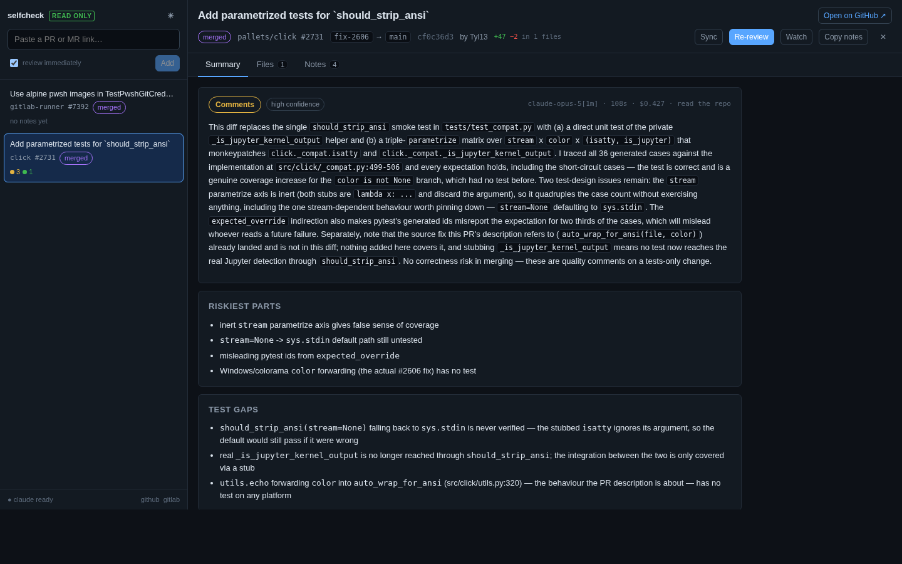
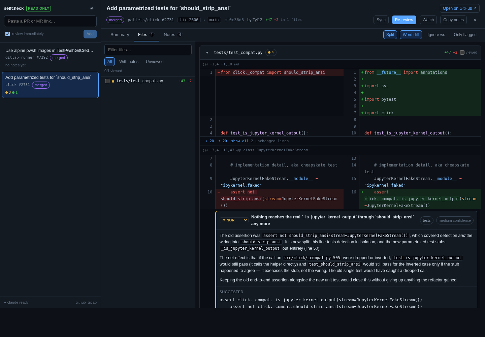

# selfcheck

A local, self-hosted review workbench for GitHub pull requests and GitLab merge
requests. Paste a link, and your locally installed Claude Code reads the change
against a read-only checkout and writes structured review notes next to the
diff.

Built for reviewing your own work before you ask for eyes on it, and for getting
oriented in someone else's PR faster.

**selfcheck never writes to a forge.** No comments, no approvals, no merges, no
labels. Notes live in a local SQLite file, and the only way one leaves is you
copying markdown out of it.



▶ **[Watch the 95-second demo](docs/demo.mp4)** — adding a PR, the review, the
diff UI, adding your own notes, a live re-review, and the light theme.

---

## What it does

- **Track PRs and MRs** by URL — github.com, gitlab.com, GitHub Enterprise, and
  self-managed GitLab.
- **Review with Claude** — it gets the diff *and* a read-only checkout of the
  head commit, so it can read whole functions, find every caller of a changed
  signature, and check whether a test already covers the new path.
- **A diff UI that earns its keep** — split or unified, real syntax highlighting
  (whole-file, so multi-line strings are not mis-coloured), word-level
  intra-line diffs, context expansion without a round trip, per-file viewed
  state, and findings rendered inline on the line they are about.
- **Re-review when the PR moves** — manually, or automatically via a watch that
  polls for new commits. Notes written against an older commit are flagged
  stale, and the re-review is told what changed since last time.
- **Your own notes too** — click any line number to add one, edit or re-triage
  Claude's, resolve/dismiss/won't-fix.
- **An API designed for Claude to drive** — plus a bundled skill, so you can do
  the review from a Claude Code session instead of from the web UI.



## Requirements

- Python 3.11+ and [`uv`](https://docs.astral.sh/uv/)
- Node 20+ and `pnpm` (only to build the UI)
- `git`
- [Claude Code](https://claude.com/claude-code) installed and authenticated
  (`claude --version` should work)
- A read-scoped token for each forge you use

## Setup

```bash
git clone <this repo> selfcheck && cd selfcheck
cp .env.example .env     # then fill in tokens, or export them in your shell
scripts/build.sh         # build the web UI
scripts/serve.sh         # http://127.0.0.1:7777
```

`scripts/dev.sh` instead runs the API with reload plus the Vite dev server on
`:5173`, proxying `/api` to the backend.

### Tokens

selfcheck reads `GITHUB_TOKEN` / `GITLAB_TOKEN` from the environment or from
`.env` (the environment wins). Ambient tokens already exported in your shell are
picked up with no configuration.

| forge | scopes needed |
| --- | --- |
| GitHub | classic PAT with `repo` (read), or fine-grained with **Pull requests: Read-only** + **Contents: Read-only** |
| GitLab | `read_api` + `read_repository` |

GitLab's newer fine-grained tokens grant permissions per resource, and one that
reads merge requests may still be refused on `/projects/:id` or `/user`. That is
fine: selfcheck treats those as enrichment and falls back to deriving the clone
URL from the host and path. Adding **Project: Read** just gets you the project's
canonical clone URL, which matters only if the project has been renamed.

For self-hosted instances, use `SELFCHECK_HOST_TOKENS` — a JSON map of host to
token:

```bash
SELFCHECK_HOST_TOKENS={"gitlab.corp.io":"glpat-…","ghe.corp.io":"ghp_…"}
```

`GET /api/status` reports which hosts have a token and whether the Claude CLI is
reachable; the sidebar footer shows the same thing.

### Getting the notes out

selfcheck never posts anything, so copying is the handoff. There are four
places to copy from, and they produce different text on purpose:

| where | gives you |
| --- | --- |
| **Copy** on a note in the diff | just the finding — paste straight into an inline review comment |
| **Copy** on a note in the Notes tab | the same, prefixed with `file:line`, for a comment that is not anchored |
| **Copy N shown** in the Notes tab | every note matching the current filter, grouped by file |
| **Copy summary** / **Copy everything** | the verdict and summary, optionally with all findings |

A note with a suggestion on a single line is copied with a ```` ```suggestion ````
fence, which both GitHub and GitLab turn into an applicable suggestion. The
clipboard falls back to a hidden-textarea copy when the async API is blocked,
and the button tells you if even that failed so nothing is silently lost.

### Keyboard

Press <kbd>?</kbd> in the app for this list.

| key | does |
| --- | --- |
| `1` `2` `3` | Summary / Files / Notes |
| `j` `k` | next / previous file |
| `n` `p` | next / previous finding — jumps to it in the diff |
| `u` | split ↔ unified |
| `w` | ignore whitespace-only changes |
| `d` | word-level intra-line diff |
| `f` | only files with open notes |
| `v` | mark the current file viewed |
| `c` | copy every open note |
| `t` | light ↔ dark |
| `r` | review (or re-review) |
| `s` | sync with the forge |
| `?` | shortcuts |

## Using it from Claude Code

`scripts/install-skill.sh` installs a `selfcheck` skill into
`~/.claude/skills/` (`--project` scopes it to this repo, `--link` symlinks
instead of copying). After that, in any Claude Code session:

> selfcheck this: https://github.com/owner/repo/pull/123

Claude tracks the PR, pulls the context, reads the code in the checkout, and
writes notes back into the UI. `GET /api/agent/guide` prints the same
instructions as plain text if you want to point some other agent at it.

## How the read-only promise is kept

This is the part worth being specific about, because "it only reads" is easy to
say and easy to get wrong.

1. **Forge traffic.** Every GitHub/GitLab call goes through `ReadOnlyClient`,
   which raises `WriteAttemptBlocked` on any verb other than `GET`/`HEAD`. There
   is no code path that can issue a POST to a forge, including by mistake.
2. **Git.** `workspace._git` refuses any subcommand outside a fixed allowlist —
   `push`, `commit`, `tag` and friends are not on it. Every mirror also has
   `remote.origin.pushurl` pinned to `selfcheck://read-only`, so even a
   hand-typed `git push` inside the cache fails before it reaches the network.
3. **Credentials.** Tokens reach git through `GIT_ASKPASS`, never embedded in a
   remote URL, so they are not written into `.git/config` and do not persist in
   the cache. The Claude subprocess gets an environment with forge tokens
   stripped out entirely — it reads a checkout, so it has no use for them.
4. **The review agent.** Claude runs with `--restricted`, an allowlist of
   `Read`/`Grep`/`Glob`, an explicit denylist covering `Write`, `Edit`, `Bash`,
   `WebFetch` and `WebSearch`, and `--strict-mcp-config` with no MCP servers, so
   no MCP tool can smuggle in a write or a network call.
5. **The checkout.** Worktrees are `chmod`-ed read-only before Claude is pointed
   at them, so a write would fail at the filesystem even if everything above
   were bypassed.
6. **Export.** The only way a note leaves selfcheck is you copying markdown from
   `Copy notes` or `GET /api/reviews/<id>/export.md`.

`scripts/test.sh` runs a suite that asserts each of these.
`scripts/smoke-ui.sh` drives a real browser against a running instance to
check what the copy buttons actually put on the clipboard.

## Architecture

```
selfcheck/
  api/            FastAPI + SQLite. No ORM, one schema, WAL.
    selfcheck/
      providers/  github.py, gitlab.py, and the read-only HTTP client
      workspace.py   fetch-only mirror cache + chmod-read-only worktrees
      claude_runner.py  drives `claude -p --output-format stream-json`
      diffparse.py   unified diff -> files/hunks/lines with absolute line numbers
      prompts.py     the review prompt and its JSON output contract
      service.py     orchestration: sync, diff cache, runs, notes
      scheduler.py   background watcher for tracked PRs
      routes/        reviews, runs+notes, agent-facing, system
    tests/
  web/            React 19 + Vite + Shiki. No UI framework, no router.
  skill/selfcheck/  the Claude Code skill
  scripts/        serve, dev, build, test, smoke-ui, install-skill
  data/           SQLite db, repo mirrors, worktrees, run logs  (gitignored)
```

### How a review run works

1. Sync metadata from the forge (`GET` only).
2. Fetch the diff. GitHub serves one directly; for GitLab a unified diff is
   rebuilt from the JSON `changes` payload.
3. Parse it into files → hunks → lines, keeping **absolute file line numbers**.
   This is what lets Claude anchor a note to a line that actually exists, which
   is the usual failure mode of LLM review tools.
4. Fetch-only mirror (`--filter=blob:none`) and a detached worktree at the head
   commit, then `chmod -R a-w`.
5. Run `claude -p` in that worktree with the diff re-rendered so every line
   carries its real line number in the gutter.
6. Parse the JSON block out of the reply, store the notes, stream progress to
   the UI over SSE.

### How the notes are written

The prompt specifies the prose, not just the analysis: conclusion first and
bolded, plain words and active voice, three to six short sentences, one finding
per note, a line or two teaching the underlying idea in ordinary language, and a
closing sentence saying what to do. Polite about the author, never vague about
the facts.

Adjectives alone did not work. Measured across re-reviews of the same pull
request, telling the model to be concise made notes 26% *longer*; adding numeric
limits (900 characters a note, 250 a paragraph, one bolded span) and a worked
example of a good note brought the median body from 763 to 644 characters and
the longest paragraph from 358 to 261, with nothing over budget. If you retune
this, re-measure rather than trusting the wording.

On a re-review, the previous run's notes and the list of files touched since
then go into the prompt, so findings that still hold keep their titles and the
summary can say what changed.

## API

`GET /docs` has the full interactive schema. The endpoints an agent needs:

| method | path | |
| --- | --- | --- |
| `POST` | `/api/reviews` | track a PR/MR by URL (idempotent) |
| `GET` | `/api/reviews/{id}/context` | diff + checkout path + existing notes, in one call |
| `POST` | `/api/reviews/{id}/notes` | write notes |
| `POST` | `/api/reviews/{id}/summary` | write the summary and verdict |
| `POST` | `/api/reviews/{id}/sync` | refetch; reports `head_changed` |
| `PATCH` | `/api/notes/{id}` | re-triage: status, severity, text |
| `GET` | `/api/reviews/{id}/export.md` | notes as markdown |
| `POST` | `/api/reviews/{id}/runs` | run selfcheck's own reviewer |
| `GET` | `/api/runs/{id}/events` | SSE progress |
| `GET` | `/api/status` | Claude CLI, tokens, cache |

## Configuration

Everything in `.env.example`, with the defaults that matter:

| variable | default | |
| --- | --- | --- |
| `SELFCHECK_HOST` / `SELFCHECK_PORT` | `127.0.0.1` / `7777` | keep it on loopback |
| `SELFCHECK_DATA_DIR` | `./data` | db, mirrors, worktrees, logs |
| `SELFCHECK_CLAUDE_MODEL` | CLI default | e.g. `claude-opus-5` |
| `SELFCHECK_RUN_TIMEOUT_SECONDS` | `900` | per review run |
| `SELFCHECK_CLONE_ENABLED` | `1` | `0` reviews from the diff alone |
| `SELFCHECK_CACHE_MAX_GB` | `10` | LRU eviction of repo mirrors |
| `SELFCHECK_WATCH_INTERVAL_SECONDS` | `300` | poll interval for watched PRs |

## Limitations

- Single user, no auth. Bind it to loopback.
- Watching polls; there are no webhooks (that would mean writing to the forge).
- Very large diffs are truncated in the prompt — Claude is told to read the rest
  from the checkout, but a 10,000-line PR is still a 10,000-line PR.
- The first review of a big repository pays for the initial fetch. It is cached
  after that.
