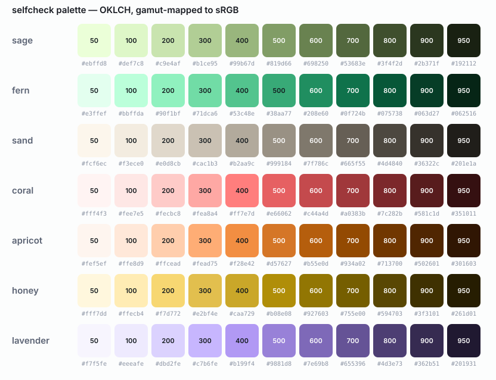

# selfcheck identity

selfcheck asks a developer to look at their own change before anyone else
does. The identity says that with as little as possible: one mark, one fresh
colour, a quiet neutral that leans towards it, and numbers you can check.
Everything here is generated by [`build.py`](build.py) and rendered by
[`render.sh`](render.sh); nothing is drawn by hand.

## The mark: the mirrored check

A check, a horizon, and the check's reflection fading below it. **The code
looking at itself** — which is what a *self*-check is. The check is the only
full-strength element; the reflection never exceeds 24% opacity and fades out
within 60% of the space below the horizon, so at small sizes it falls away and
a plain check is what remains.

| File | Use it on |
| --- | --- |
| [`logo/mark.svg`](logo/mark.svg) | anything: teal-to-sage check on the ink tile. The app icon. |
| [`logo/mark-light.svg`](logo/mark-light.svg) | light pages that want a tile |
| [`logo/mark-bare-dark.svg`](logo/mark-bare-dark.svg) / [`-light`](logo/mark-bare-light.svg) | no tile, on dark or light surfaces |
| [`logo/favicon.svg`](logo/favicon.svg) | 16-32 px: no reflection |
| [`logo/lockup-dark.png`](logo/lockup-dark.png) / [`-light`](logo/lockup-light.png) | mark and wordmark together |
| [`logo/og-card.png`](logo/og-card.png) | link previews, 1200 by 630 |

- **Construction.** On a 64-unit tile with corner radius 15: the check runs
  through (17.5, 28.5), (27, 38), (46.5, 17) with a 7.2 stroke and round caps
  and joins; the horizon sits at y = 42.5 from x = 13 to 51; the reflection is
  the check mirrored about the horizon.
- **Clear space.** Half the tile on every side. **Smallest size:** 16 px with
  the tile (favicon variant), 24 px without.
- **Don't** recolour the check outside the teal-sage gradient, drop the tile
  on mid-grey, put the reflection at full strength, or set the wordmark in
  anything but Inter.

## Colour

Seven families, each an eleven-step scale from 50 to 950, defined in **OKLCH**
(so equal steps look equal to the eye) and gamut-mapped into sRGB by lowering
chroma until the colour fits. [`tokens.css`](tokens.css) and
[`tokens.json`](tokens.json) carry every step.

| Family | Hue | Role |
| --- | --- | --- |
| **teal** | 190 | brand, focus, links, the check |
| **sage** | 160 | pass, additions, the second accent |
| **slate** | 222 | text, surfaces, borders |
| **coral** | 22 | blocker, failure, deletions |
| **apricot** | 55 | major, warning |
| **honey** | 92 | minor, caution |
| **lavender** | 295 | question, merged |

**Why teal.** Developer tools live in blue and purple; green means "your build
passed" and red "your build broke". Teal sits between the trust of blue and the
go of green without being either, so it can be the brand *and* sit next to the
status colours without being mistaken for one. It reads as fresh, not loud.

**Why the neutrals lean blue-green.** Pure grey next to teal looks dirty; a
slate tinted towards the accent's hue (222, with chroma held under 0.025) makes
surfaces, text and accent read as one family. The light theme's page is a
barely-cool off-white for the same reason.

**Why the status hues sit at the same weight.** Coral, apricot, honey, sage
and lavender share lightness and chroma, so a blocker stands out by meaning
(its hue and its label), not by being louder than everything else.

**Charts** take a separate, validated categorical order (blue, orange, aqua,
yellow, magenta) checked for colour-vision-deficiency separation against both
surfaces; the heatmap is a single-hue teal ramp.

### Contrast

Every text colour clears WCAG 2.2 AA (4.5:1) on every surface it is used on;
body text clears 7:1. `build.py` fails if a pairing drops below its target —
see [`contrast.md`](contrast.md).

## Type

**Inter** for everything you read, **JetBrains Mono** for code, paths and
numbers that need to line up. Both are bundled into the app, so it looks the
same offline. The wordmark is Inter at weight 650 with tight tracking (-0.03 em),
`self` in the text colour and `check` in teal.

## Voice

Plain, specific, calm. Say what happened and what to do next. The product's
own review notes follow the same rules: conclusion first, short sentences,
polite about people, never vague about facts.

## Media

The promo video and featurettes in [`video/`](video/) are recorded from a real
instance by [`video/record.mjs`](video/record.mjs) against public repositories
and a local demo branch — see the [media page](https://unchained-labs.github.io/selfcheck/media/).
