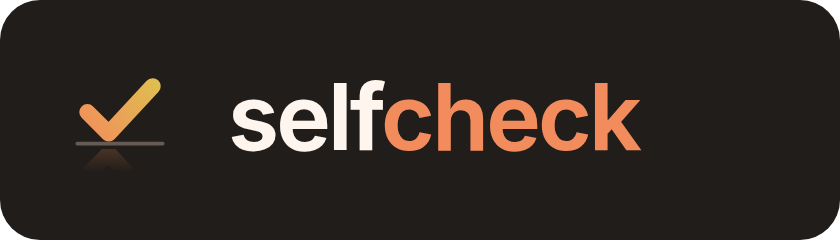
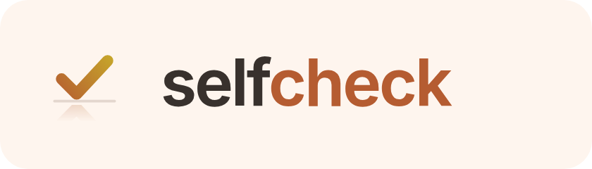
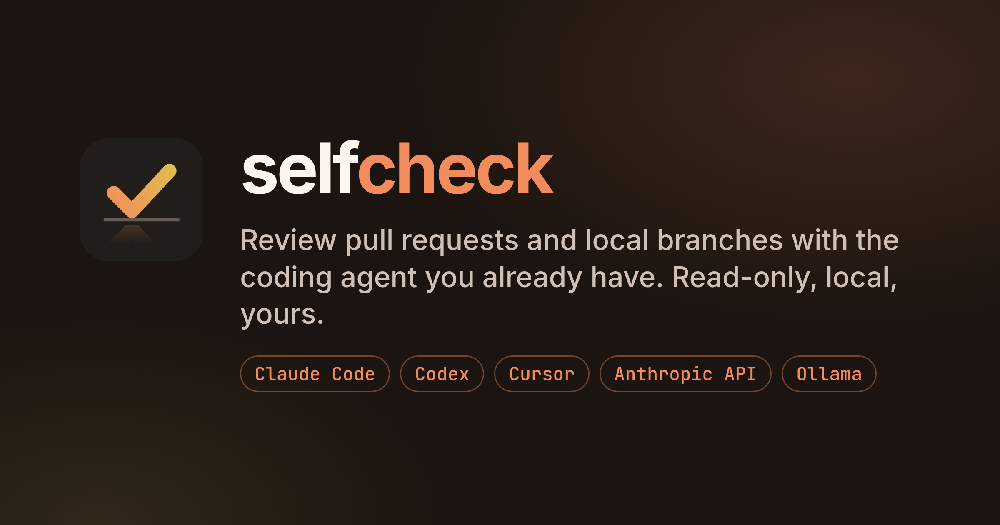

# Brand

The identity is generated, not drawn: [`branding/build.py`](https://github.com/Unchained-Labs/selfcheck/blob/main/branding/build.py)
computes the mark, the palette and the contrast checks, and
[`render.sh`](https://github.com/Unchained-Labs/selfcheck/blob/main/branding/render.sh)
renders the PNGs. The full guide is
[`branding/README.md`](https://github.com/Unchained-Labs/selfcheck/blob/main/branding/README.md).

{ width="420" }

## The mirrored check

A check, a horizon, and the check's reflection fading below it: the code
looking at itself, which is what a *self*-check is. The reflection never
exceeds 24% opacity, so at favicon size a plain check is what remains.

| | |
| --- | --- |
| { width="96" } | **Mark** — rust-to-honey check on the ink tile. The app icon. [SVG](assets/brand/mark.svg) |
| { width="48" } | **Favicon** — no reflection, for 16-32 px. [SVG](assets/brand/favicon.svg) |
| { width="300" } | **Lockups** — [dark](assets/brand/lockup-dark.png), [light](assets/brand/lockup-light.png) |
| { width="300" } | **Social card** — 1200 by 630. [PNG](assets/brand/og-card.png) |

## Colour

Seven families, each an eleven-step scale defined in OKLCH, so equal steps
look equal, and gamut-mapped into sRGB.

- **Rust** (hue 45) is the brand: oxidised copper, warm and welcoming without
  shouting, next to cocoa and parchment neutrals.
- **Cocoa** neutrals make the surfaces a deep cocoa in the dark theme and
  parchment in the light one, so surfaces, text and accent read as one family.
- **Coral, amber, honey, fern and lavender** carry blocker, major, minor,
  pass and question at the same weight. Major sits at amber, clear of the
  brand, so severity is read from meaning, not volume.
- Every text pairing clears **WCAG AA (4.5:1)** on every surface it is used on;
  the build fails if one drops below.

## Type

**Inter** for reading, **JetBrains Mono** for code and numbers. Both are
bundled into the app. The wordmark is Inter 650, `self` in the text colour,
`check` in rust.
