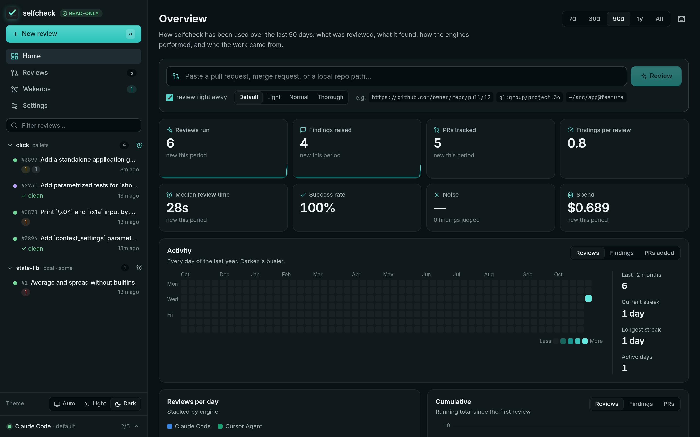
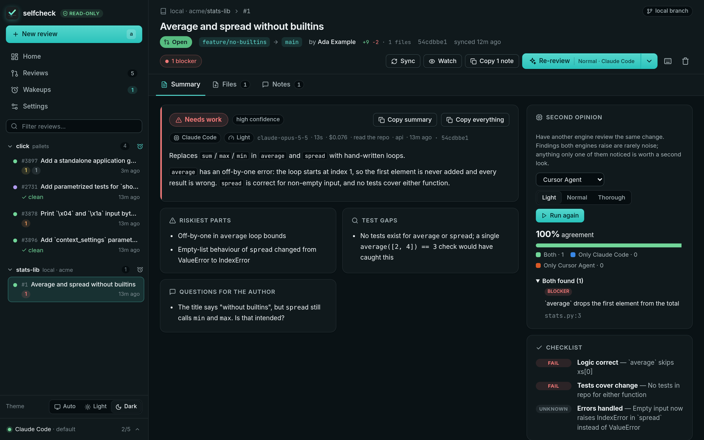
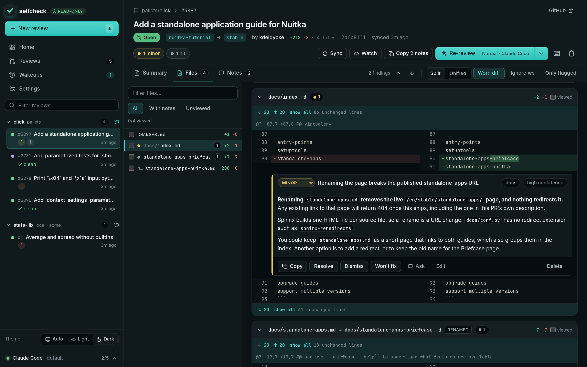
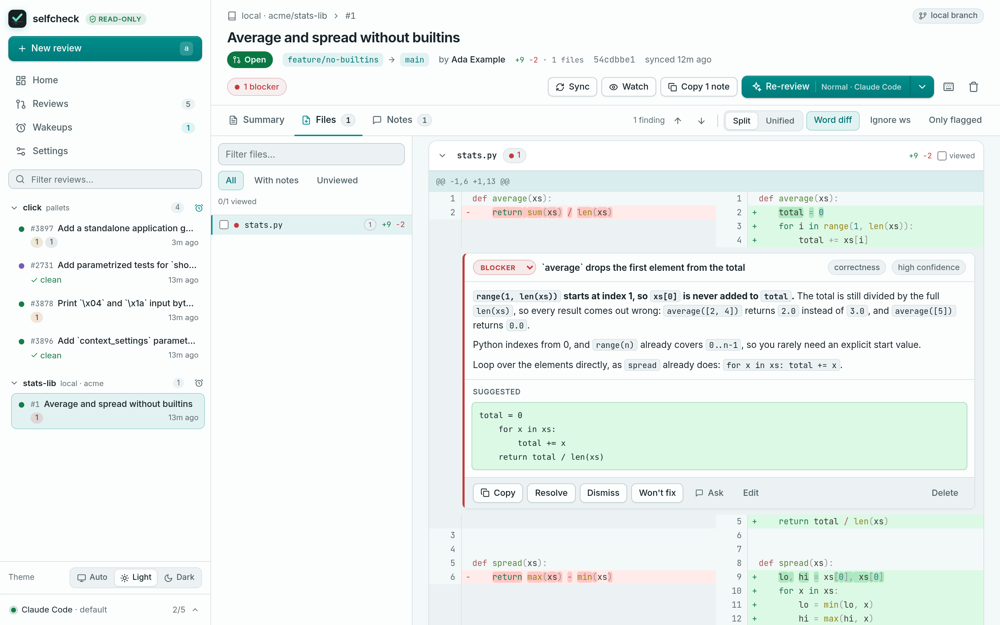

# Media

Everything here is recorded from a real selfcheck run — real reviews by real
engines — against public repositories (`pallets/click`) and two small local
demo repositories. [`branding/video/seed.py`](https://github.com/Unchained-Labs/selfcheck/blob/main/branding/video/seed.py)
sets the instance up, [`record.mjs`](https://github.com/Unchained-Labs/selfcheck/blob/main/branding/video/record.mjs)
drives it, [`build.sh`](https://github.com/Unchained-Labs/selfcheck/blob/main/branding/video/build.sh)
cuts it.

## The promo

<video class="sc-video" src="../assets/media/selfcheck-promo.mp4" poster="../assets/media/selfcheck-promo.jpg" controls muted playsinline></video>

[Download (MP4, 91 s)](assets/media/selfcheck-promo.mp4)

## Featurettes

**The dashboard**
<video class="sc-video" src="../assets/media/selfcheck-dashboard.mp4" controls muted playsinline></video>

What was reviewed, what it found, and the reviews behind every number.

**A review, start to finish**
<video class="sc-video" src="../assets/media/selfcheck-review.mp4" controls muted playsinline></video>

Paste a pull request; read the verdict and the findings in the diff.

**Ask about a finding**
<video class="sc-video" src="../assets/media/selfcheck-ask.mp4" controls muted playsinline></video>

A local branch, and a question checked against the code.

**Second opinion**
<video class="sc-video" src="../assets/media/selfcheck-second.mp4" controls muted playsinline></video>

Another engine, side by side, with an agreement score.

**Wakeups**
<video class="sc-video" src="../assets/media/selfcheck-wakeups.mp4" controls muted playsinline></video>

A repository on a schedule, and what the next check will do.

**Engines, on the fly**
<video class="sc-video" src="../assets/media/selfcheck-engines.mp4" controls muted playsinline></video>

Switch engine, model, depth and theme without a restart.

## Stills

